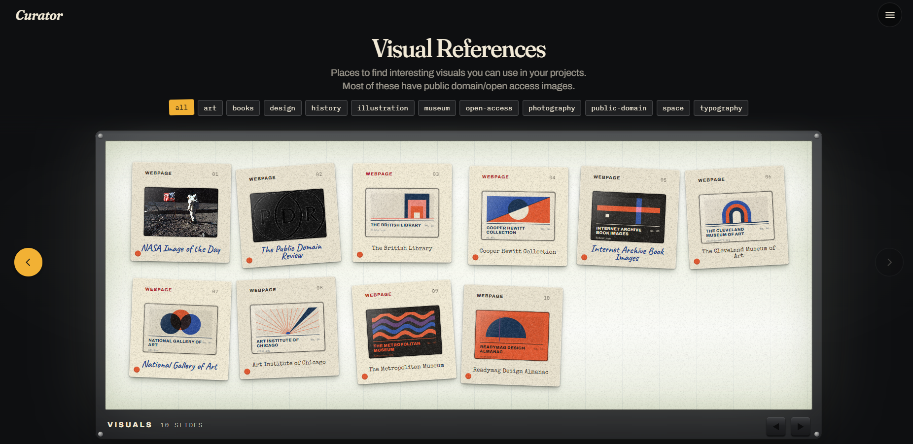
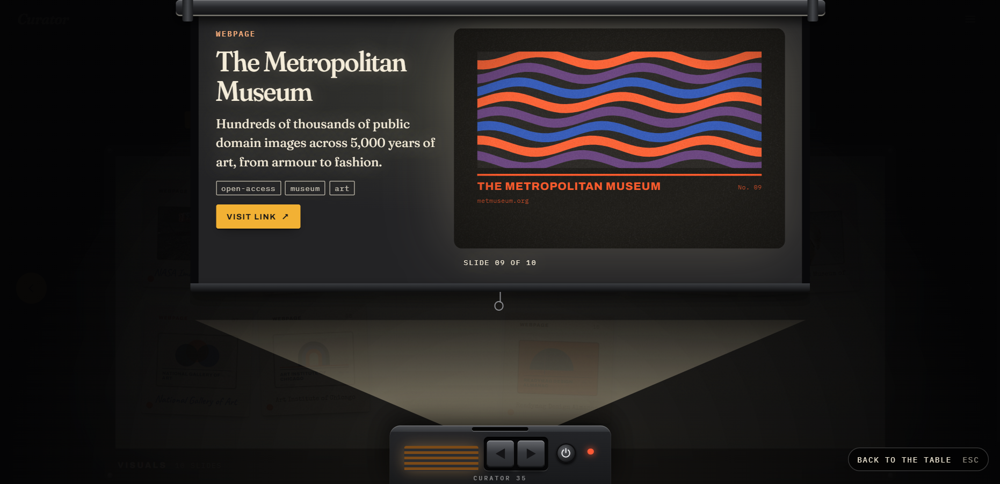

# Curator

 

Curator is a retro-inspired way to share collections of links. Every link is a 35mm slide laid out on a light table.

Click one and it drops into a projector, while a screen rolls down to show the all the slide content, including the notes you've added to the link.

You write each collection as a Markdown file with a title, notes and tags for every link. Curator turns your files into a small static website.

The output is plain files you can upload to any static host. Serve it from the root of a domain or subdomain.

## Why I Built This

I wanted an interesting way to share the links I keep coming back to, such as code repositories, articles, videos, images and websites. Most link lists are flat and forgettable. I wanted something that would be fun to browse.

## Requirements

Node 20 or newer. There is nothing to install, because Curator has no dependencies.

## Quickstart

1. Fork or clone this repo into a Git repository of your own.
2. Run `npm run dev` and open `http://localhost:4321`.
3. Replace the sample collections in `content/` with your own, and update `basic.collections` in `curator.config.json` to match.
4. Set your site title and address in `curator.config.json`.
write 5. Run `npm run check` to validate everything.
6. Connect your repository to a static host that runs `npm run build` and serves `dist/`.

## Documentation

- [GETTING-STARTED.md](docs/GETTING-STARTED.md): the user manual. Read it first, from a fresh copy to a live site.
- [CONFIG.md](docs/CONFIG.md): every setting, brand colour, font and scene colour token.
- [DEPLOY.md](docs/DEPLOY.md): hosts, domains, the 404 page, build errors and the checks to run on the live site.
- [ARCHITECTURE.md](docs/ARCHITECTURE.md): how the build, front end and scene fit together, and the rules for changing them.
- [INDEX.md](docs/INDEX.md): the full list of docs.

For quick answers to common questions, see [FAQs in GETTING-STARTED.md](docs/GETTING-STARTED.md#faqs).

## Commands

To make and publish your site you only need `dev`, `check` and `build`. The other commands are for changing Curator itself.

| Command | Does |
|---------|------|
| `npm run dev` | Builds, serves on `http://localhost:4321` and rebuilds on change. `--port <n>` changes the port |
| `npm run build` | Production build into `dist/`. `--offline` makes no network requests and uses only what is cached. `--refresh-images` refetches every preview image, and `--refresh-images=<collection>/<item>` refetches one |
| `npm run check` | Validates the config and content without writing output. It also accepts `--offline` |
| `npm test` | Unit tests |
| `npm run test:browser` | Browser tests in headless Chrome or Edge, on a build of their own. `--only <name>` runs one page and `--url <base>` tests a running server instead |
| `npm run perf` | Measures the performance requirements in a headless browser |
| `npm run shots` | Takes screenshots for review into `.cache/shots/`. `--out <dir>` changes the folder |
| `npm run docs` | Regenerates `docs/CONFIG.md` from the schema and the CSS |

`dev`, `build` and `check` also take `--root <folder>` to work on a project in another folder.

## License

MIT. See [LICENSE](LICENSE).
